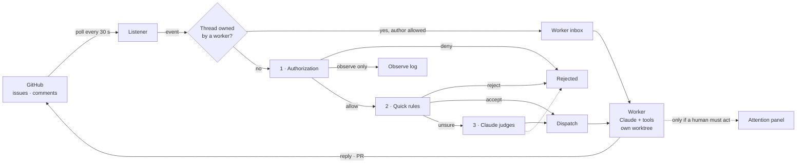

# casiagent

An AI teammate for a GitHub repository. casiagent watches issues and pull requests, checks whether it is allowed to help, does the work with Claude in its own copy of the code, opens a pull request, follows up on review comments, and only asks a human when one is really needed.

```text
@casiagent-bot please fix the bug in the checkout test
        │
        ▼
  allowed? → quick rules → Claude judges → worker fixes it in its own worktree
        │                                         │
        └──────── reply + pull request #12 ◀──────┘   (questions and failures → attention panel)
```

> **Status:** feature-complete and covered by 340 automated tests that use fake Claude and GitHub APIs. It has not yet been run against a real repository. Start with a throwaway repository.

## Contents

- [What it does](#what-it-does)
- [How it works](#how-it-works)
- [Safety](#safety)
- [Quick start](#quick-start)
- [Configuration](#configuration)
- [The attention panel](#the-attention-panel)
- [Project structure](#project-structure)
- [Development](#development)
- [Documentation](#documentation)
- [Limitations](#limitations)

## What it does

| Step | What happens |
| --- | --- |
| **Listen** | Polls the repository every 30 s for new issues, comments, review comments, assignments and labels. The read position is saved, so restarts neither miss nor replay events. |
| **Decide** | Three gates, cheapest first: a rules file (who, where, what), an instant keyword filter, and only for unclear requests a judgement by Claude. |
| **Work** | Each accepted job gets its own worker, its own notebook and its own git worktree on branch `casiagent/<task id>`. Claude (`claude-opus-5-5`) uses a small, fixed tool set, then reports through a validated result form. |
| **Follow up** | Comments on the issue or the worker's pull request go straight to the same worker, which remembers the whole job. |
| **Heal** | Workers send heartbeats; a watchdog restarts stalled ones up to 3 times, then escalates. A minute-by-minute maintenance pass retries, abandons stale work and cleans up. |
| **Stay quiet** | A local web panel lists only what a human must act on, plus what the agent noticed but was not allowed to do. |

**Explicit vs inferred requests.** An event is an explicit request when it @-mentions the bot, assigns the issue to it, or adds a configured label. Anything else is *inferred*: it is only logged in the observe log ("would have done …"), never acted on, unless the team writes an `auto_act` rule for it.

## How it works



The worker's tools are `read_file`, `list_files`, `search`, `write_file`, `run_tests`, `commit_and_push` and `open_pr`, and every run ends with `submit_result` (`output`, `status: DONE | AWAITING_FEEDBACK`, `artifacts`, optional `attention`). Results are saved before replies are posted, so a GitHub outage never loses or repeats work.

## Safety

| Risk | Protection |
| --- | --- |
| A stranger asks it to act | Only `allowed_users` can start work; everyone else is denied before any AI call. |
| It acts on work nobody asked for | Inferred work is observe-only; the default for it can never be `allow`. |
| A stranger instructs it on its own pull request | Follow-ups are authorized too: only allowed users and listed CI bots reach a worker. |
| It replies to its own replies | Posts by the bot account are ignored. |
| Prompt injection | Requests are passed to Claude as fenced, untrusted data; answers are schema-validated. |
| File access outside the task | Paths are confined to the worktree, including symlinks; `.git` is off limits. |
| Code executing through git | Every git command runs with hooks disabled (`core.hooksPath=/dev/null`). |
| Changes to `main` | Pushes go only to the task's own branch, by explicit refspec. |
| Secret leakage | Tests run with a minimal environment; the GitHub token is never sent to another host or written in errors; config files hold variable names, never secrets. |
| Panel abuse | Binds to `127.0.0.1`, optional bearer token, strict CSP, text-only rendering, same-origin JSON for writes. |

> **Accepted trade-off:** `run_tests` runs the repository's own test command on your machine with your user's file access (no credentials, but no container). Point casiagent at repositories whose tests you trust.

## Quick start

### Prerequisites

- [Bun](https://bun.sh) 1.4 or later, and git
- A repository for the agent to work on, and a local clone of it from which `git push` works
- A GitHub account for the bot (or your own, for a first try) with a fine-grained token: **Issues** read/write, **Pull requests** read/write, **Contents** read
- An Anthropic API key, or an `ant auth login` profile

### Install and check

```sh
bun install
bun run check        # type-check, lint, architecture rules, tests
```

### Configure

```sh
cp config/casiagent.example.yaml     config/casiagent.yaml
cp config/authorization.example.yaml config/authorization.yaml
cp .env.example                      .env
```

1. In `config/casiagent.yaml`, set `github.owner`, `github.repo`, `github.bot_login`, `workspace.repo_path` (your clone) and `workspace.test_command`.
2. In `config/authorization.yaml`, list `allowed_users` and `allowed_sources` (for example `github:your-org/your-repo`) and adjust the rules.
3. In `.env`, fill in `GITHUB_TOKEN` and `ANTHROPIC_API_KEY`. Bun loads `.env` automatically; all three copies are ignored by git.

### Run

```sh
bun run start                                  # uses config/casiagent.yaml
bun run start --config path/to/other.yaml      # or another config file
```

It prints the repository it watches and the panel address (default `http://127.0.0.1:4317`). Then open an issue in the repository that mentions the bot with a small, safe request.

Press **Ctrl-C** to finish in-progress work and exit; press it again to exit at once. Interrupted work resumes on the next start.

## Configuration

`config/casiagent.yaml` is validated strictly at startup: unknown keys, wrong types and secrets written where an environment variable name belongs are rejected with the exact field named. Relative paths resolve against the config file's folder.

| Setting | Default | Meaning |
| --- | --- | --- |
| `database` | required | SQLite file holding all state |
| `authorization_file` | required | Who may ask for what (see below) |
| `authorization_rules` | empty | Plain-language rules Claude reads for unclear requests |
| `filter.keyword_patterns` | none | Phrases that accept an allowed request without asking Claude |
| `github.poll_interval_seconds` | 30 | Polling interval |
| `github.request_labels` | none | Labels that count as an explicit request |
| `github.token_env` | `GITHUB_TOKEN` | Name of the variable holding the token |
| `workspace.test_command` | none | For example `["bun", "test"]`; omit to disable `run_tests` |
| `llm.model` | `claude-opus-5-5` | Model for judging and for tasks |
| `llm.task_timeout_minutes` | 30 | Wall-clock limit per task run |
| `llm.task_token_budget` | 200000 | Token budget per task run (minimum 20,000) |
| `llm.context_budget_tokens` | 100000 | Notebook size before older messages are archived |
| `limits.max_evaluation_attempts` | 3 | Failed judgements before a request is rejected |
| `limits.abandon_awaiting_after_days` | 7 | How long a job may wait for review feedback |
| `panel.port` / `panel.token_env` | 4317 / unset | Panel address; optional bearer token variable |

The authorization file in short (full example in `config/authorization.example.yaml`):

```yaml
allowed_users: ["alice", "bob"]
allowed_sources: ["github:org/repo"]
trusted_followup_authors: ["github-actions[bot]"]   # may post follow-ups, never start work
rules:                                               # first match wins
  - pattern: "deploy to prod|drop table"
    action: deny            # allow | deny | observe_only | auto_act
    scope: any              # explicit_request | inferred | new_work (default) | follow_up | any
  - pattern: "fix bug|reproduce issue"
    action: allow
    scope: explicit_request
defaults:
  explicit_request: allow
  inferred: observe_only    # may only be observe_only or deny
  follow_up: allow
```

## The attention panel

A local web page that stays empty while everything is healthy. It shows:

- **Needs your attention:** `QUESTION`, `REVIEW_REQUEST`, `WORKER_FAILED`, `DELIVERY_FAILED`, `WATCHDOG_ESCALATION`, `EVALUATION_FAILED`, `WORK_ABANDONED`, `ROUTING_LOOP`, each with a **Mark resolved** button.
- **Observed, not acted on:** what the agent would have done, and why it did not.

API: `GET /api/attention-items`, `GET /api/observe-log`, `POST /api/attention-items/:id/resolve`.

## Project structure

A Bun + TypeScript monorepo following Clean Architecture: dependencies point inward only, and outside systems are plugged in through ports.

```text
packages/
  domain/        entities, value objects, ports, pure rules       (no dependencies at all)
  application/   use cases, router, context manager, prompts      (depends on domain)
  adapters/      SQLite, GitHub, Claude, worktree tools,           (depends on domain + application)
                 watchdog, panel server, authorization
apps/
  runtime/       composition root: config, createRuntime, main.ts
config/          example configuration and authorization files
docs/            the casiagent handbook (HTML)
scripts/         architecture and test-hygiene checks
```

The Dependency Rule is enforced, not just documented: `domain` and `application` compile without Bun or Node types, and `bun run arch` fails on any import that points outward, type-only imports included.

## Development

| Command | Does |
| --- | --- |
| `bun run check` | Everything below plus a check for unawaited test assertions, in order. Must pass before a change is done. |
| `bun run type-check` | TypeScript (strict) for every package |
| `bun run lint` / `bun run lint:fix` | Biome lint and format |
| `bun run arch` | Dependency Rule check |
| `bun test` | All tests (`bun test packages/adapters` for one package) |
| `bun run start` | Run the agent |

**Testing approach.** No test calls the real Claude or GitHub APIs. Fakes speak the real wire formats (JSON and server-sent events for Claude; paginated, rate-limited REST for GitHub) behind the real SDK. Every store runs a shared contract suite in both its in-memory and SQLite form; worktree tools are tested against real git repositories; and a crash-recovery test restarts a "dead" worker from a second process on the same database. Each safeguard was also removed on purpose to confirm a test fails without it.

Conventions for contributors are in [`CLAUDE.md`](CLAUDE.md): named exports, `interface` for object shapes, `as const` status objects instead of enums, ids and time injected through ports.

## Documentation

- **[The casiagent handbook](docs/casiagent-ebook.html)**, from novice to professional: a plain-language walkthrough, every stage of the pipeline, the safety model, architecture, state machines, concurrency, operations, testing, and 95 use cases across software, e-commerce, finance, banking, healthcare, education, legal, retail, logistics, insurance, hospitality, telecom, real estate and more. Open the file in a browser.
- **[`CLAUDE.md`](CLAUDE.md)**: the build roadmap and the working notes recording every design decision.

## Limitations

- `run_tests` is not sandboxed (see [Safety](#safety)); child processes of a timed-out test run may survive it.
- GitHub pull request review summaries and CI check results are not polled yet; CI systems that post comments do get through.
- One agent process per database file.
- GitHub is the only source; other sources (chat, CI, helpdesks) would be new adapters behind the same `SourcePort`.
- Not yet run against a real repository.

## License

No license file has been added yet. Choose one before sharing or publishing the code.
